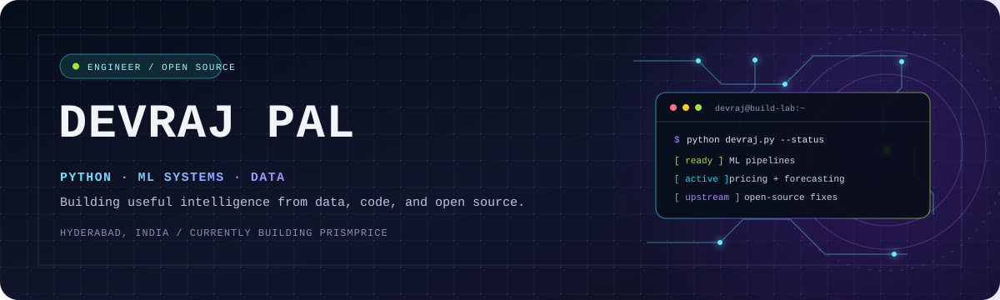

<div align="center">



<br />

<a href="https://linkedin.com/in/devraj-pal"></a>
<a href="mailto:connectingwithdev@gmail.com"></a>
<a href="https://github.com/pulls?q=is%3Apr+author%3Aitzzdev09+is%3Amerged"></a>
<a href="https://github.com/itzzdev09"></a>

<strong>Python · ML systems · Data engineering · Open source</strong>

</div>

---

## `profile.load()`

```python
>>> devraj.whoami()
{
    "base":      "Python",
    "focus":     ["ML pipelines", "pricing & forecasting", "data-heavy backends"],
    "stack":     ["pandas", "scikit-learn", "PyTorch", "FastAPI", "Kafka", "Redis"],
    "location":  "Hyderabad, India",
    "sidequest": "reading other people's code until I find the bug",
}
>>> devraj.currently()
"shipping PrismPrice and sending fixes upstream"
```

## `git log --author=itzzdev09 --merged`

Selected upstream work across data tools, developer infrastructure, and scientific Python.

| Repository | Contribution signal |
|---|---|
| [fsspec/filesystem_spec](https://github.com/fsspec/filesystem_spec) | Filesystem behavior across memory, ZIP, TAR, and wrapped filesystems; Windows path parsing; `cat_file` offsets. |
| [shenxianpeng/gitstats](https://github.com/shenxianpeng/gitstats) | Annotated-tag commit counts, safe HTML/SVG names, and clear errors when a commit is missing. |
| [sqlfluff/sqlfluff](https://github.com/sqlfluff/sqlfluff) | Oracle `FETCH ... PERCENT` and PostgreSQL `COPY` options across versions 15–18. |
| [mvt-project/mvt](https://github.com/mvt-project/mvt) | Whole-path indicator matching, URL normalization, and parsers resilient to truncated diagnostics. |
| [PythonOT/POT](https://github.com/PythonOT/POT) | Fixed swapped arguments in UCOOT entropic regularization. |
| [pymovements/pymovements](https://github.com/pymovements/pymovements) | Categorical and Enum BIDS export, temporal-gap plotting, and screen plotting. |
| [zhouxiaoka/autoclip](https://github.com/zhouxiaoka/autoclip) | Subtitle retries without re-downloading video and accurate millisecond carry in SRT timestamps. |
| [Farama-Foundation/PettingZoo](https://github.com/Farama-Foundation/PettingZoo) | `PadActionSpace` and `NanZeros` wrappers for AEC and parallel environments. |

[Explore merged pull requests →](https://github.com/pulls?q=is%3Apr+author%3Aitzzdev09+is%3Amerged)

## `~/projects`

| Project | What it does |
|---|---|
| [PrismPrice](https://github.com/itzzdev09/PrismPrice) | Pricing decision support: demand elasticity, retention, and causal revenue optimization. `Python` `scikit-learn` `pandas` |
| [XAI-PyTorch-IDS](https://github.com/itzzdev09/XAI-PyTorch-IDS) | Explainable multi-class intrusion detection using SHAP on imbalanced data. `PyTorch` `CatBoost` `SHAP` |
| [dynamic-pricing-pipeline](https://github.com/itzzdev09/dynamic-pricing-pipeline) | Streaming pricing pipeline with reinforcement learning. `Kafka` `Redis` |
| [delhi-rent-forecasting](https://github.com/itzzdev09/delhi-rent-forecasting) | Delhi rental forecasting with classical ML and LSTM models. |
| [PrepArsenal](https://github.com/itzzdev09/PrepArsenal) | AI-assisted exam prep with question analysis and adaptive practice. `Python` `TypeScript` `Supabase` |
| [price-tracker](https://github.com/itzzdev09/price-tracker) | E-commerce price monitoring with email alerts. |

## `stack.inspect()`

<div align="center">


<br />

<br />


</div>

## `telemetry.report()`

[](https://itzzdev09.github.io/itzzdev09/)
[](https://itzzdev09.github.io/itzzdev09/)
[](https://itzzdev09.github.io/itzzdev09/)
[](https://itzzdev09.github.io/itzzdev09/)

<div align="center">
<br />
<sub><code>SESSION OPEN // BUILD SOMETHING THAT MATTERS</code></sub>
<br />
<sub>Thanks for stopping by. See you in the next deploy. 👋</sub>
</div>
